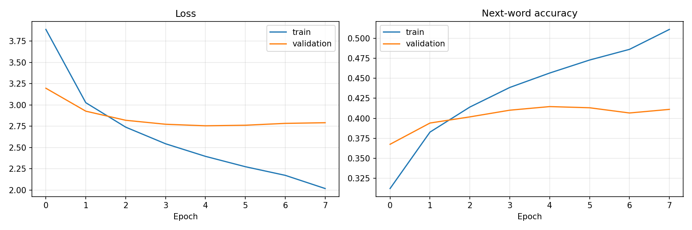
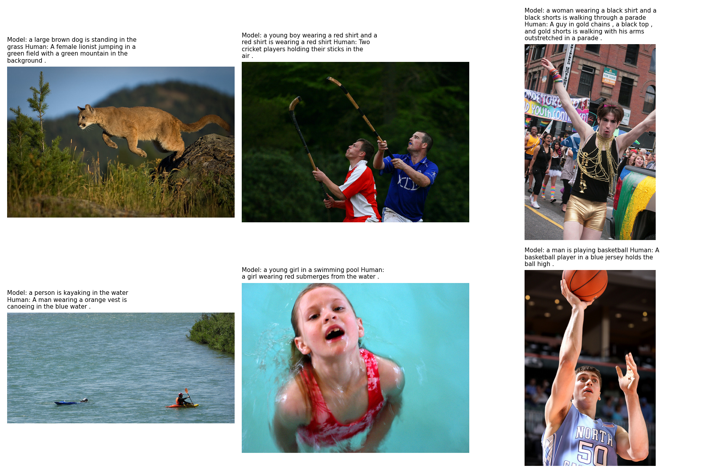

# 🖼️ AI Image Caption Generator (CNN + Transformer)

[](https://colab.research.google.com/github/Anuanshika/Image-Caption-Generator/blob/main/Train_on_Colab.ipynb)
[](https://ai-image-captioner.streamlit.app)

A deep learning project that **looks at a photo and writes a sentence describing it**. A pretrained CNN understands the image, a Transformer decoder writes the caption word by word, and attention heatmaps show **where the model looked for each word**.

**Live demo:** https://ai-image-captioner.streamlit.app *(replace with your URL after deploying)*

---

## How it works

```
Photo (224×224)
   │
   ▼
EfficientNetB0 (pretrained on ImageNet, frozen)
   │  7×7 grid = 49 region features × 1280
   ▼
Image encoder: Dense(256) + 1 self-attention layer   ← regions share context
   │
   ▼                              "<start> a dog runs ..."
Transformer decoder × 2  ◄──────── word + position embeddings
  • masked self-attention   (each word sees only earlier words)
  • cross-attention         (each word looks at image regions → heatmaps)
  • feed-forward
   │
   ▼
Dense(vocab) → next word → repeat until <end>
```

**Decoding:** *greedy* (best word each step) or *beam search* (keeps the k best sentences, length-normalised).

## Dataset

[Flickr8k](https://www.kaggle.com/datasets/adityajn105/flickr8k) (Kaggle, `adityajn105/flickr8k`), downloaded automatically with `kagglehub`. It contains 8,091 images with 5 human captions each.

| Split | Images | Captions |
|---|---|---|
| Train | 6,473 | ~32k |
| Validation | 809 | ~4k |
| Test | 809 | ~4k (never seen in training) |

Splits are by **image**, so the same photo never appears in two splits.

## Training details

| Setting | Value |
|---|---|
| Image features | pre-extracted once and cached (makes training fast) |
| Vocabulary | words appearing ≥ 5 times (~2,900 words) |
| Max caption length | 30 tokens |
| Decoder | 2 layers, d_model 256, 4 heads, FF 512, dropout 0.2 |
| Loss | cross-entropy ignoring padding (teacher forcing) |
| Optimiser | Adam 3e-4, gradient clipping, LR halving on plateau, early stopping |

## Results

Created in `reports/` after training:

| File | Content |
|---|---|
| `training_curves.png` | loss and next-word accuracy per epoch |
| `bleu_scores.json` | BLEU-1…4: greedy on all test images, beam vs greedy on 200 |
| `examples.png` | test images with model vs human captions |

Models of this size on Flickr8k usually land around BLEU-1 ≈ 0.55–0.65 and BLEU-4 ≈ 0.15–0.22. Paste your own numbers here:

| Decoding | BLEU-1 | BLEU-2 | BLEU-3 | BLEU-4 |
|---|---|---|---|---|
| Greedy | – | – | – | – |
| Beam (k=3) | – | – | – | – |




## Project structure

```
image-caption-generator/
├── app.py                # Streamlit web app
├── captioner.py          # inference: greedy, beam search, attention maps
├── model.py              # EfficientNet encoder + Transformer decoder
├── tokenizer.py          # word vocabulary (JSON)
├── data_utils.py         # Kaggle download, captions, splits, batches
├── features.py           # CNN feature extraction + caching
├── train.py              # full training pipeline
├── evaluate.py           # BLEU scores + example images
├── viz.py                # attention heatmap overlay
├── config.py             # paths and hyperparameters
├── notebooks/Train_on_Colab.ipynb
├── model/                # trained weights go here
├── reports/              # plots and scores
├── tests/                # pytest tests
├── requirements.txt      # app (Streamlit Cloud)
└── requirements-train.txt
```

---

## Step-by-step guide

### Step 1: Put the code on GitHub
Create a **public** repo named `image-caption-generator`, then:
```bash
cd image-caption-generator
git init
git add .
git commit -m "Initial commit: image caption generator"
git branch -M main
git remote add origin https://github.com/<your-username>/image-caption-generator.git
git push -u origin main
```

### Step 2: Train (Google Colab, free GPU, ~40 min)
1. Click **Open in Colab** above (edit the badge link if your username differs).
2. `Runtime → Change runtime type → T4 GPU`.
3. Set `REPO_URL` in cell 2, then `Runtime → Run all`.
4. `model_files.zip` and `report_files.zip` download at the end.

*Local alternative:* `pip install -r requirements-train.txt` then `python train.py`. A GPU is strongly recommended.

### Step 3: Add the model to GitHub
Put `encoder.weights.h5`, `decoder.weights.h5`, `config.json`, `vocab.json` into `model/` (about 35 MB total), and the report files into `reports/`:
```bash
git add model/ reports/
git commit -m "Add trained model and results"
git push
```

### Step 4: Run locally (optional)
```bash
pip install -r requirements.txt
streamlit run app.py
```

### Step 5: Deploy and get your LIVE URL (free)
1. Go to https://share.streamlit.io and sign in with GitHub.
2. **Create app → Deploy a public app from GitHub**.
3. Repo `<your-username>/image-caption-generator`, branch `main`, file `app.py`.
4. **App URL:** e.g. `ai-image-captioner` → `https://ai-image-captioner.streamlit.app`.
5. **Advanced settings → Python 3.12** → **Deploy** (first build 3–5 min).
6. Put the live URL at the top of this README.

---

## Tests
```bash
pip install pytest
pytest -q
```
Includes a check that the decoder really learns to describe the image (on a toy colour dataset), save/load of model files, beam and greedy decoding, and attention maps.

## Troubleshooting

| Problem | Fix |
|---|---|
| `Kaggle download failed` | `import kagglehub; kagglehub.login()` once, or set `KAGGLE_USERNAME` / `KAGGLE_KEY`. |
| "Model files not found" in the app | The 4 files are not in `model/` on GitHub. |
| Error loading weights on Streamlit Cloud | `config.json` → `trained_with` shows the Keras/TF versions used in Colab. Pin those in `requirements.txt` (e.g. `tensorflow-cpu==2.19.0`). |
| Out of memory in Colab | `python train.py --batch-size 32` |
| Captions are generic or odd | Expected on unusual photos: Flickr8k mostly shows people, dogs and outdoor scenes. |

## Ideas to extend
- Fine-tune the last CNN blocks for better image understanding
- Train on Flickr30k or MS-COCO for richer captions
- Add text-to-speech so captions are read aloud (accessibility)
- Report METEOR / CIDEr alongside BLEU

## Disclaimer
Educational project. Captions can be wrong or biased; they reflect the training data.

## License
MIT. Dataset licence: see the Kaggle dataset page.
